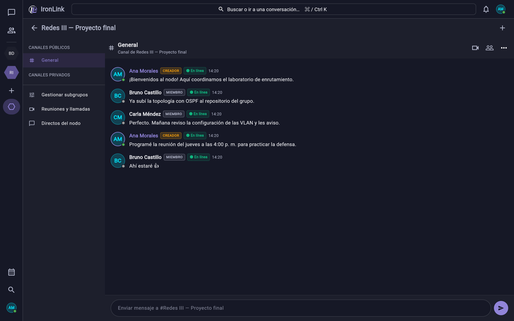
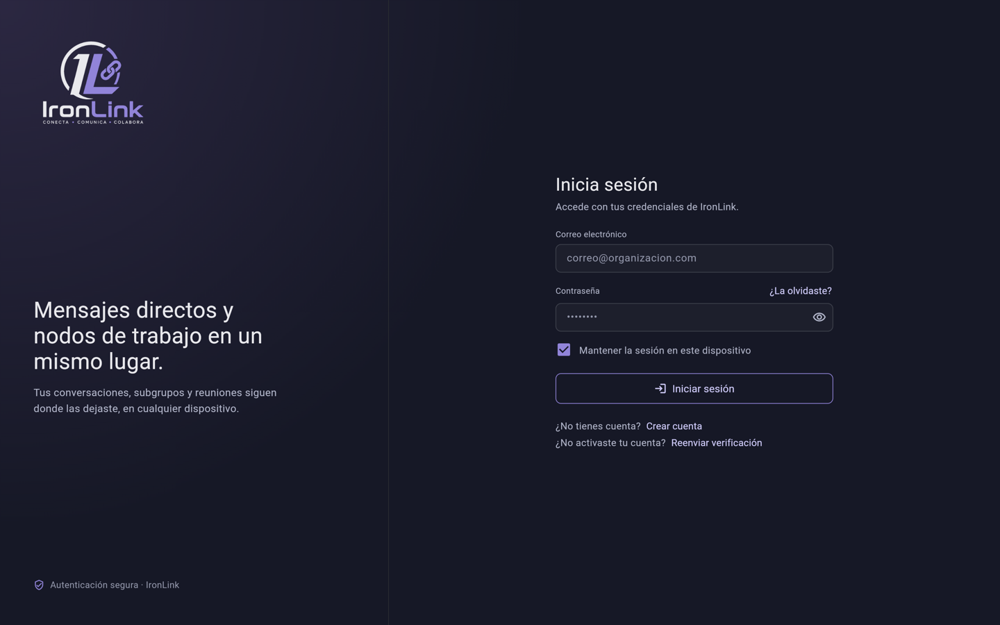
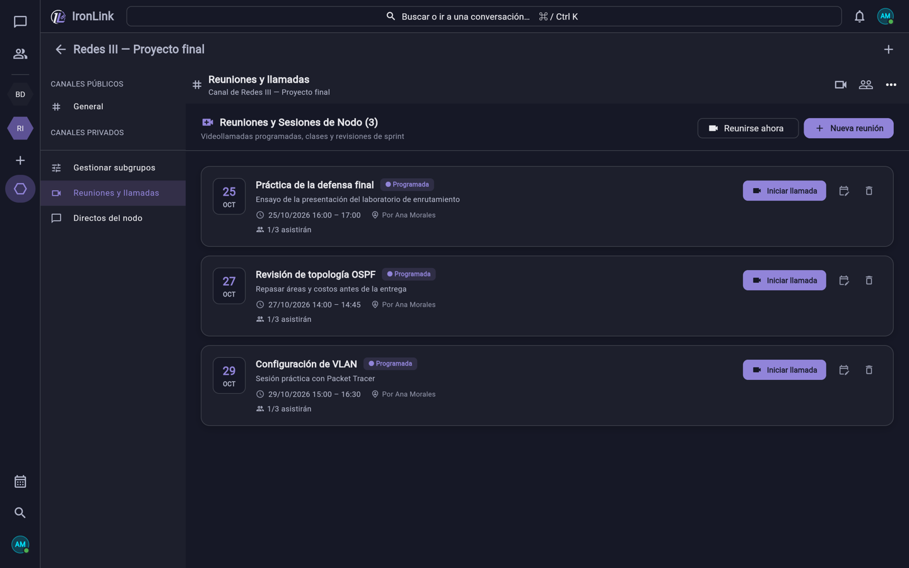

# IronLink

**Plataforma de colaboración académica en tiempo real**: espacios de trabajo ("nodos"), chat persistente, mensajes directos, reuniones programadas y videollamadas P2P, con un backend en Rust y una app multiplataforma en Flutter.

Proyecto desarrollado por el equipo **InnovaSoft** (7 integrantes) en la asignatura Ingeniería de Software II de la Universidad Gerardo Barrios (El Salvador), con Scrum en sprints de dos semanas.


---

## Capturas

**Espacio de trabajo con chat persistente**



| Inicio de sesión | Reuniones programadas |
|---|---|
|  |  |

<sub>Capturas de la app web real con cuentas y datos de prueba.</sub>

## Funcionalidades

- **Cuentas seguras**: registro con verificación por correo (código o enlace), contraseñas con Argon2id, JWT con refresco y cierre de sesión, recuperación de contraseña con códigos de un solo uso.
- **Nodos (espacios de trabajo)**: crear, unirse por invitación, roles (propietario, moderador, miembro), expulsiones y bloqueos.
- **Subgrupos** públicos y privados dentro de cada nodo.
- **Chat persistente** por nodo, mensajes directos, amigos y estado de lectura.
- **Reuniones**: programación con calendario, consulta de disponibilidad, asistencia y salas de grupos (*breakout rooms*).
- **Videollamadas P2P** de hasta 3 participantes en malla (*mesh*) con WebRTC; el servidor solo retransmite la señalización por WebSocket con pases de un solo uso.
- **Pizarra colaborativa** y **notificaciones en vivo**.
- **Correos transaccionales** en HTML (SMTP con `lettre`).

## Arquitectura

```
┌──────────────────────────┐        HTTPS / REST (JSON)         ┌───────────────────────────┐
│  App Flutter              │ ─────────────────────────────────▶ │  Backend Rust (Axum)      │
│  macOS · Windows · iOS ·  │                                    │  · auth, nodos, chat,     │
│  Web                      │ ◀──── WebSocket /live/ws ────────▶ │    reuniones, amigos      │
│  Riverpod · GoRouter ·    │ ◀──── WebSocket /rtc/ws ─────────▶ │  · señalización WebRTC    │
│  Dio · flutter_webrtc     │        (señalización)              │  · correos (SMTP)         │
└────────────┬─────────────┘                                    └─────────────┬─────────────┘
             │  audio / video P2P (WebRTC, sin pasar por el servidor)          │ SQLx
             ▼                                                                 ▼
      otros participantes                                            PostgreSQL 18 (Docker)
```

- El backend está organizado por módulos de dominio (`auth`, `nodos`, `chat`, `rtc`, `live`, `calendar`, `amigos`, `notifications`, `whiteboard`, `mailer`).
- El esquema de base de datos evoluciona con **20 migraciones SQL** versionadas (`backend/migrations`).
- Los medios de la videollamada viajan directamente entre dispositivos; el servidor valida la identidad de cada mensaje de señalización y limita su tamaño.

## Stack

| Capa | Tecnologías |
|---|---|
| Backend | Rust (edición 2024), Axum 0.8, Tokio, SQLx, Argon2, jsonwebtoken, lettre |
| Base de datos | PostgreSQL 18 en Docker Compose |
| Frontend | Flutter / Dart, Riverpod, GoRouter, Dio, flutter_webrtc, flutter_secure_storage |
| Pruebas | `cargo test` (74 pruebas), `flutter test` (29 archivos), E2E con Playwright y Python |
| Proceso | Scrum, Trello, revisiones de calidad con SonarQube |

## Cómo ejecutarlo

### Requisitos
- Docker y Docker Compose
- Rust (stable, con soporte de edición 2024)
- Flutter SDK 3.x

### 1. Base de datos
```bash
docker compose up -d
```

### 2. Backend
```bash
cd backend
cp .env.example .env   # completa DATABASE_URL, JWT_SECRET y los datos SMTP
cargo run              # aplica las migraciones y escucha en http://127.0.0.1:8080
```

### 3. Frontend
```bash
cd frontend
flutter pub get
flutter run -d macos   # o -d chrome / -d windows
# Para apuntar a otra API:
# flutter run --dart-define=API_BASE_URL=http://192.168.1.10:8080
```

### 4. Pruebas
```bash
cd backend && cargo test
cd frontend && flutter test
```

## Mi rol

Soy **Ludwin Vásquez**, estudiante de Ingeniería en Sistemas y Redes Informáticas. En este proyecto fui:

- **Scrum Master** del equipo de 7 personas: planificación de sprints, dailies, revisiones y retrospectivas; gestión del tablero y de las definiciones de *Ready* y *Done*.
- **Líder de backend y arquitectura**: diseñé la arquitectura cliente-servidor, el modelo de datos en PostgreSQL y la API en Rust/Axum; implementé la autenticación (Argon2id + JWT con refresco), el chat, la señalización WebRTC para videollamadas P2P y las actualizaciones en vivo por WebSocket.
- Coordiné la calidad del código: pruebas automatizadas, corrección de hallazgos de seguridad y revisiones con SonarQube.

## Equipo

Desarrollado por el equipo InnovaSoft — Universidad Gerardo Barrios, 2026.

> Este repositorio es una copia pública del proyecto, publicada con autorización del equipo y sin datos personales ni credenciales.
